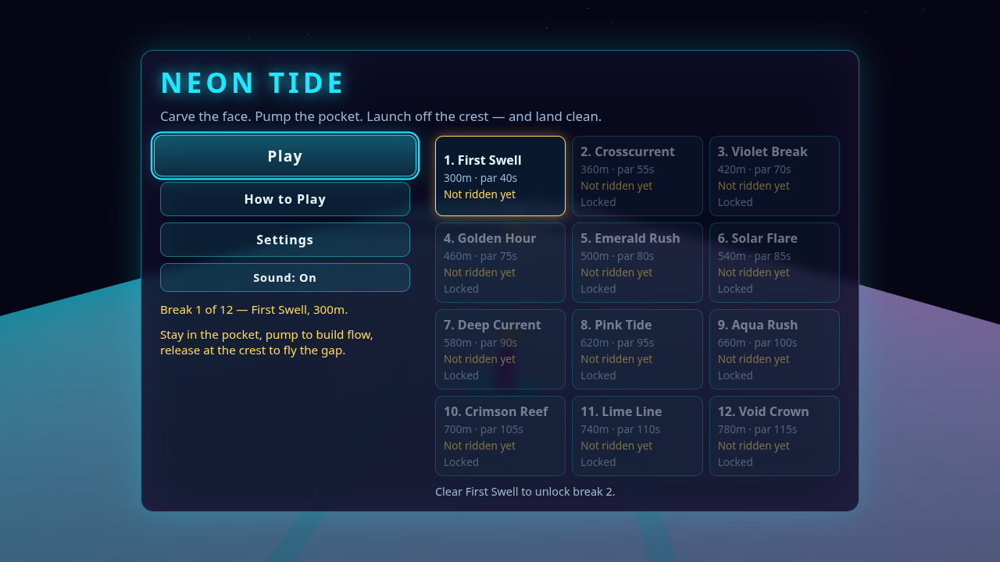
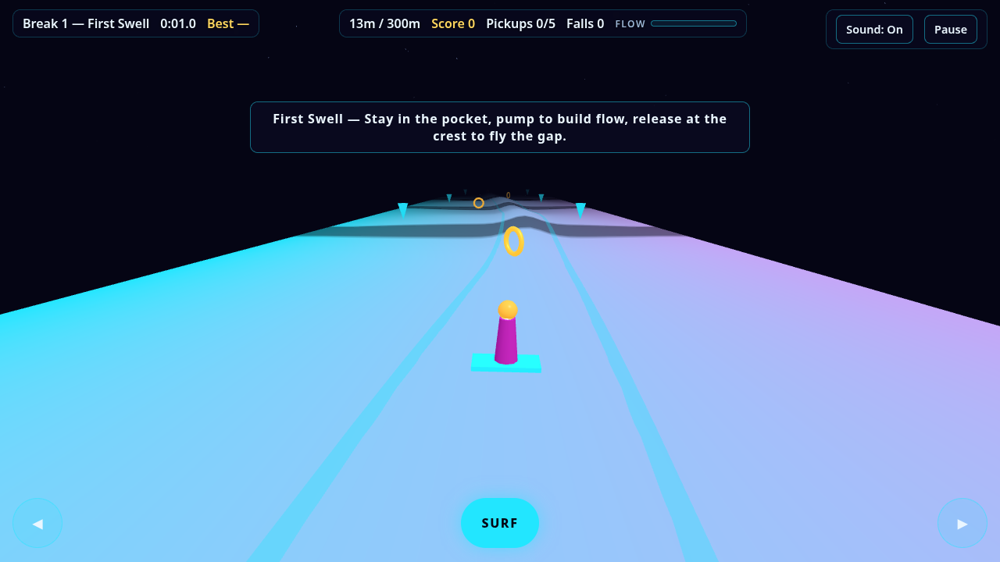

# Neon Tide — 3D Neon Wave-Surfer

Carve the wave face, pump for speed, launch off the crest — and land clean in the pocket.

**Play it live:** https://namdev-muse.github.io/neon-tide/

## The game

You ride a rolling neon wave down a channel. The **pocket** — the fast water — drifts across the wave face as the break runs, and staying in it is the whole game.

- **Carve with A / D or Left / Right** to track the pocket. Drift out of it and the wave leaves you behind.
- **Hold Space / mouse / SURF to pump** — crouch into the wave while you are in the pocket to build speed and **FLOW**. Pumping outside the pocket bogs the board down.
- **Release Space at a crest** to launch for air. The wave face ends at every crest — ride into the gap and you wipe out. Land clean in the pocket to keep your combo going.
- Collect **gold pickups** along the good lines for score. Pass a **checkpoint** and a wipeout sends you back there, not to the start.
- Fall off the face, land badly, or stall out and the run ends. **5 falls** ends the break. Ride the full channel to clear it.
- Your **best score** is saved per break. Clearing a break unlocks the next one. Ranks: **S** (no falls, under par), **A** (under par), **B** (cleared) — your best rank per break is saved and shown as a badge on the break card.

## Breaks (M1: 3)

| # | Break | Length | Par |
|---|-------|--------|-----|
| 1 | First Swell | 300m | 40s |
| 2 | Crosscurrent | 360m | 55s |
| 3 | Violet Break | 420m | 70s |

## Controls

- A / D or Left / Right: carve · Hold Space / mouse button: pump · Release Space at a crest: jump
- **P**: pause · **M**: mute · **R**: restart
- Touch: hold **SURF** to pump, drag left/right to carve
- **Esc** closes a panel · **Enter** confirms on menus

## Tech

- Three.js 0.160.0 (pinned, jsdelivr import map), vanilla HTML/CSS/JS, Web Audio API synth SFX, no build step, GitHub Pages from `main` / root.
- Pure simulation core in `physics.js` (no DOM, no Three.js) — deterministic fixed-step wave-ride sim, driven through public input hooks by the bot harness.
- Game feel: trauma screen shake (real-time decay), hit-stop, FOV punch, pooled spray particles, score pops, FLOW meter + pump ticks that rise in pitch with flow, synth SFX + generative music (Am–F–C–G bass + arpeggio that lifts an octave at speed).
- Tests: `npm test` (smoke 88 + bot gates), `npm run render-check` (headless Chromium: menu, demo, accessibility toggles, screen-space carve, pump flow, autopilot clear, wipeout/respawn, pause, shake, rest state, `?break=` unlock path, FPS guard), `npm run screenshots` (1280x720 / 2560x1080 / 1080x2340, menu + gameplay + pause, inspected by eye; refreshes `docs/screenshots/`).

## Version

v0.1.0 (M1 core: local build — repo creation + live playtest at the 02:30 milestone run). See [docs/DEVLOG.md](docs/DEVLOG.md) for the sprint log.

## Known issues (v0.1.0)

- M1 is a local build only — not yet pushed or live-playtested; the 02:30 milestone run owns repo creation, upload and the live FUN playtest.
- Portrait framing leaves large vertical empty bands above/below the action (same caveat class as Apex/Bastion/Spire).
